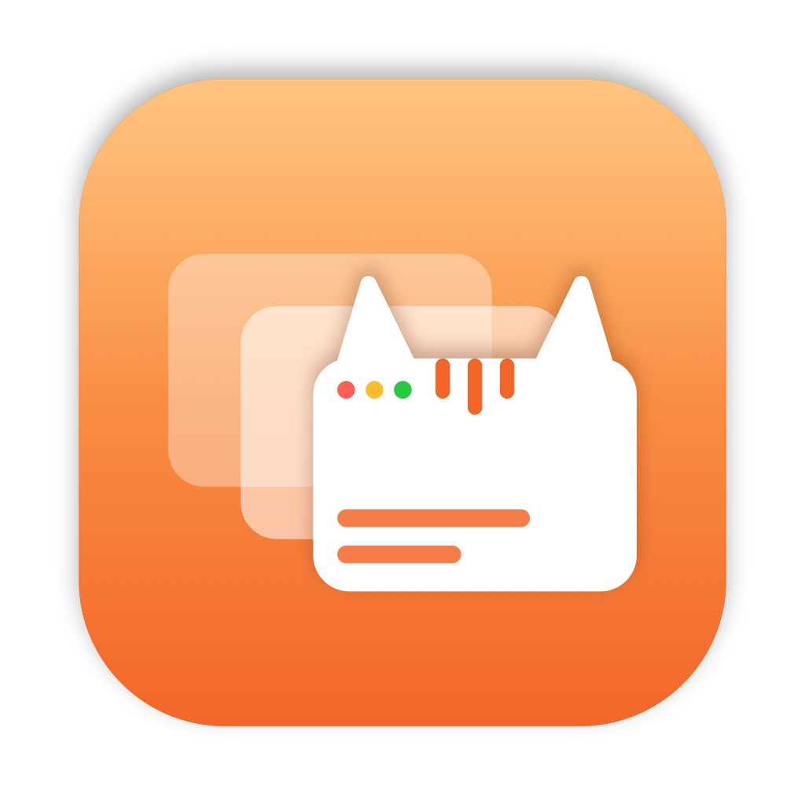

<div align="center">



# Tabby

**A minimal ⌥Tab app switcher for macOS.**
Hold ⌥, tap Tab, see every app as a live window preview, let go to switch.


[](https://github.com/aimen08/tabby/releases/latest)
[](https://buymeacoffee.com/aimen08)

[**↓ Download**](https://github.com/aimen08/tabby/releases/latest/download/Tabby.dmg) · [Website](https://aimen08.github.io/tabby/) · [Install](#install) · [Build](#build-from-source)

</div>

---

## Features

- **Live previews**: each app's front window, captured with ScreenCaptureKit, falling back to the app icon
- **Most recent first**: apps are ordered by when you last used them, like ⌘Tab
- **Quit from the switcher**: hover a preview for ✕ (quit) and ⚡ (force quit); the switcher stays open
- **Instant flip**: a quick ⌥Tab tap jumps to your last app without showing the panel
- **Every Space**: the panel shows on the current desktop and over full-screen apps
- **Menu bar only**: no Dock icon; the menu shows permission status, pause, launch at login, updates and quit
- **Auto-updates**: Sparkle-signed updates, signed with a stable certificate so your permissions survive them

## Shortcuts

| Action                       | Keys          |
|------------------------------|---------------|
| Open switcher / next app     | `⌥Tab`        |
| Previous app                 | `⌥⇧Tab`       |
| Move selection               | `←` `→`       |
| Switch to selected app       | release `⌥`, `↩`, or click |
| Cancel                       | `esc`         |
| Quit / force quit an app     | hover a preview, click ✕ / ⚡ |

---

## Install

### Homebrew

```bash
brew tap aimen08/tabby https://github.com/aimen08/tabby
brew install --cask aimen08/tabby/tabby
```

Use the full `aimen08/tabby/tabby` name: plain `tabby` is a different app (the Tabby terminal) in Homebrew's main catalogue.

### Manual

1. Download **[Tabby.dmg](https://github.com/aimen08/tabby/releases/latest/download/Tabby.dmg)** and drag **Tabby.app** into **Applications**
2. Open it. Tabby isn't notarized, so macOS blocks the first launch: go to **System Settings → Privacy & Security** and click **Open Anyway**
3. Allow **Accessibility** (required, for the ⌥Tab shortcut)
4. Allow **Screen Recording** (optional, for previews; quit and reopen Tabby after granting)

Quit AltTab or any other switcher that uses ⌥Tab first. Requires macOS 14 or later.

---

## Build from source

Needs Xcode 16+ (Swift 5.9, macOS 14 SDK).

```bash
git clone git@github.com:aimen08/tabby.git
cd tabby

swift run                     # run in dev
./Scripts/launch.sh           # build dist/Tabby.app and launch it
./Scripts/make-dmg.sh         # package dist/Tabby.dmg
./Scripts/release.sh          # build, sign, publish a GitHub release, update appcast + cask
```

**Stable permissions:** macOS ties Accessibility and Screen Recording to the app's signature. Put the name of a code-signing certificate from your keychain in `.signing-identity` (gitignored); without it builds are ad-hoc signed and you have to re-grant after every build.

**Auto-updates:** releases are signed with an Ed25519 key kept in `.sparkle-keys/private_key` (gitignored, back it up). Its public half is `.sparkle-public-key`. `release.sh` signs the DMG, prepends it to `appcast.xml` and bumps `Casks/tabby.rb`. Releases are cut locally rather than in CI, because CI can't sign with your certificate.

**Icon and social image:** `./Scripts/make-icon.swift` and `./Scripts/make-og.swift` redraw them from code.

---

## Support

Tabby is free and open source. If it saves you some time:

<p><a href="https://buymeacoffee.com/aimen08"></a></p>

<div align="center">
<sub>MIT licensed. Built with Swift, AppKit, and Claude.</sub>
</div>
